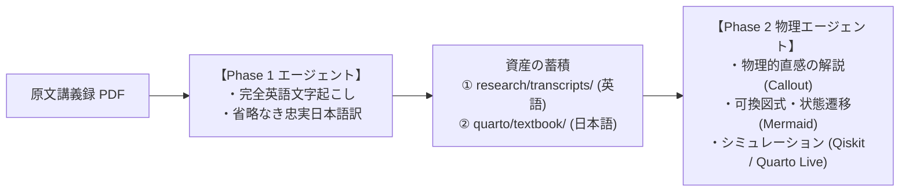
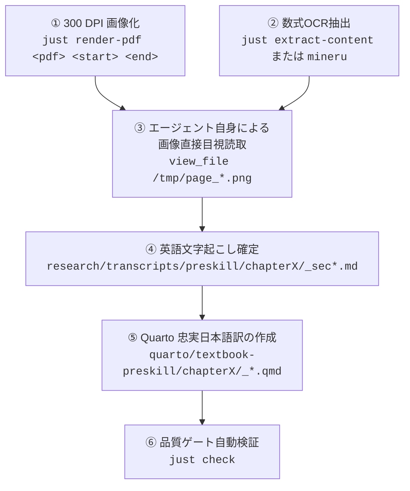

# Quantum Information 教科書制作 引き継ぎ書 (HANDOFF.md)

> [!IMPORTANT]
> **エージェントへの指示**: 本プロジェクトに参加したエージェントは、**このドキュメントを先頭から読むだけで直ちに作業を開始・引き継ぎできるように設計されています**。他のドキュメントを探す必要はありません。

---

## 1. プロジェクトの全体像と二段階体制 (Phase 1 / Phase 2)

本プロジェクトは、ジョン・プレスキル（John Preskill）の講義録を中心とした量子情報科学の教科書を、世界最高品質の Web 教科書（Quarto）として構築するプロジェクトです。
専門性と作業精度を最大化するため、**二段階のエージェント分業体制** を採用しています。



### 役割分担の原則
1. **Phase 1（現担当）**:
   - 原文の記述、数式、定理、証明、式番号、脚注を **1つも省略せずに日本語化** する（ゴールデンルール）。
   - 後続の Phase 2 エージェントが PDF 画像を再読取しなくて済むよう、数式を含めた **高精度な英語原文文字起こし（Transcripts）** を作成して保存する。
2. **Phase 2（物理専門エージェント）**:
   - Phase 1 が作成した文字起こしをベースに、物理的背景の解説、直感的図解、Qiskit ノートブック、対話シミュレーションを追記・拡充する。

---

## 2. 作業環境 (Mac Studio 単一ディレクトリ)

作業は計算資源の豊富な **Mac Studio (`studio`)** 上の **単一ディレクトリ** で行います。

| 項目 | 設定値 / パス | 備考 |
| :--- | :--- | :--- |
| **マシン名 / IP** | `studio` (`100.94.63.34`) | Tailscale 接続済み |
| **作業ディレクトリ** | `/Users/daisukeyamashiki/Code/Learning/Quantum-information` | **エディタ・エージェントはこのディレクトリを開いて作業** |
| **作業ブランチ** | `feature/phase1-transcription-and-faithful-translation` | PR #2 に紐づくブランチ |
| **パッケージ管理** | `uv` (Python 3.12), `bun` (JavaScript) | Mac 共通ポリシー準拠 (bare pip / npm 禁止) |
| **タスクランナー** | `just` | ビルド・検証・PDF処理はすべて `just` 経由で実行 |
| **主要ツール** | `quarto 1.10.x`, `mineru 4.0.x` (UniMERNet) | インストール・動作確認済み |

---

## 3. 確定した標準ワークフロー（三重照合 Tri-Stream パイプライン）

Phase 1 の文字起こしおよび忠実和訳は、以下の **「三重照合パイプライン」** に完全に従って進めます。



### なぜこの手順が必要か？（三重照合の理由）
- 最新の数式 OCR（MinerU や Marker）であっても、微細な上付き・下付き添字（例: $\boldsymbol{\sigma}_1$ と $\boldsymbol{\sigma}_3$）、太字表記（$\boldsymbol{\rho}$）、式番号の欠落が稀に発生します。
- そのため、**エージェント自身が画像ファイル（`/tmp/page_XX.png`）を `view_file` で直接目視確認し、OCR テキストと突き合わせて 100% の精度に校正します**。

---

## 4. 現在の進捗状況 (Preskill Chapter 2)

| セクション | 物理ページ | 英語文字起こし (`research/transcripts/`) | Quarto 忠実和訳 (`quarto/textbook-preskill/`) | ステータス |
| :--- | :--- | :--- | :--- | :--- |
| **2.1 状態の重ね合わせ** | p.1 〜 p.8 | ⏳ 未着手 | 既存草稿あり（要照合・追記） | **👉 次の着手タスク** |
| **2.2 シュミット分解** | p.9 〜 p.14 | ⏳ 未着手 | 既存草稿あり（要照合・追記） | 次期タスク |
| **2.3 エンタングルメントの幾何学** | p.15 〜 p.20 | ⏳ 未着手 | 既存草稿あり（要照合・追記） | 次期タスク |
| **2.4 デコヒーレンス** | p.21 〜 p.25 | ⏳ 未着手 | 既存草稿あり（要照合・追記） | 次期タスク |
| **2.5 アンサンブル解釈の曖昧さ** | p.26 〜 p.35 | ✅ `_sec2.5_ambiguity.md` (式 2.97-2.121) | ✅ `_2.5-ambiguity.qmd` (HJW, 遅延選択完了) | **完了 (PR #2)** |
| **2.6 状態間の距離** | p.36 〜 p.41 | ✅ `_sec2.6_distance.md` (式 2.122-2.161) | ✅ `_2.6-distance-between-quantum-states.qmd` | **完了 (PR #2)** |
| **2.7 演習問題** | p.42 〜 p.45 | ⏳ 未着手 | 既存草稿あり | 次期タスク |

---

## 5. 次のエージェントが今すぐ実行する作業手順 (Step-by-Step)

次のエージェントは、**Section 2.1（状態の重ね合わせ: p.1〜p.8）** から作業を開始してください。

### 手順 1: PDF の画像化
```bash
cd /Users/daisukeyamashiki/Code/Learning/Quantum-information
just render-pdf quarto/assets/pdf/preskill/chap2.pdf 1 8
```
- `/tmp/page_1.png` 〜 `/tmp/page_8.png` が生成されます。

### 手順 2: テキスト・数式の抽出
```bash
just extract-content quarto/assets/pdf/preskill/chap2.pdf 1 8
```
- コンソールに OCR テキストと LaTeX 数式が出力されます。

### 手順 3: エージェントによる画像直接目視確認
- `view_file` ツールで `/tmp/page_1.png` から順に開き、OCR 出力と比較して誤植や欠落を修正します。

### 手順 4: 英語文字起こしファイルの作成
- 保存先: `research/transcripts/preskill/chapter2/_sec2.1_superposition.md`
- ルール: 原文の文章を忠実に書き起こし、数式には `$$ ... $$ {#eq-2.XX}` 形式で式番号を付与します。

### 手順 5: Quarto 日本語忠実和訳の反映
- 反映先: `quarto/textbook-preskill/chapter2/_2.1-superposition-of-states.qmd`
- ルール:
  - 定義・定理・証明・式番号を 1 つも省略しない。
  - 見出しは `## 2.1 ...` の配下を `### 2.1.X ...` で統一する。
  - 既存のわかりやすい解説 Callout があれば破壊せず保持する。

### 手順 6: 品質検証とコミット
```bash
# 全体検証 (Lint, Format, Quarto HTML ビルド, Mermaid)
just check

# コミット & プッシュ
git add research/transcripts/preskill/chapter2/_sec2.1_superposition.md quarto/textbook-preskill/chapter2/_2.1-superposition-of-states.qmd
git commit -m "feat(preskill): complete Section 2.1 transcription and faithful translation"
git push origin feature/phase1-transcription-and-faithful-translation
```

---

## 6. Phase 2（物理専門エージェント）への引き継ぎルール

Phase 1 が完了したセクション（現在は Section 2.5, 2.6）について Phase 2 エージェントを起動する場合のプロトコルです：

1. **入力ソース**:
   - Phase 2 エージェントは、PDF 画像を読み直す必要はありません。
   - `research/transcripts/preskill/chapter2/` 配下の Markdown を直接読み込んで物理的内容を把握します。
2. **追記・拡充ルール**:
   - `quarto/textbook-preskill/chapter2/` の既存の翻訳テキストや数式は絶対に削除・要約しないでください。
   - 物理的直感の解説は `::: {.callout-note appearance="simple"}` で追加します。
   - 状態遷移やプロトコルは Mermaid 図式（`graph TD`, `sequenceDiagram` 等）で可視化します。
   - 計算の具体例やシミュレーションは `quarto/qiskit/` 配下のノートブックや Quarto Live コードで提供します。
3. **完了検証**:
   - 変更後は必ず `just check` を実行し、Mermaid 構文や数式エラーがないことを確認します。
