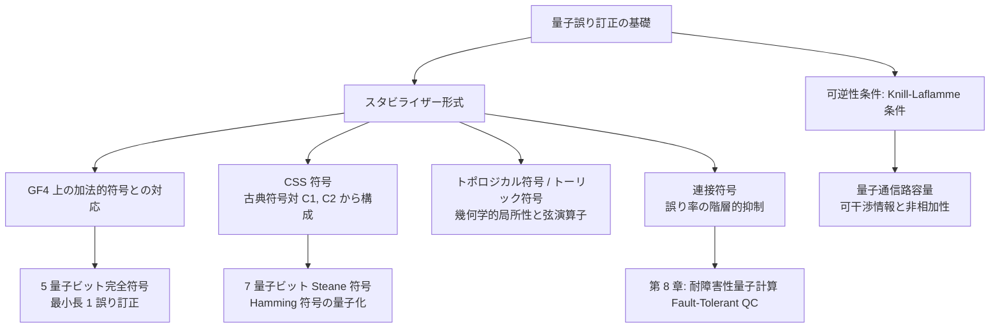

## 7.24 要約 (Summary) [📄 chap7.pdf](/assets/pdf/preskill/chap7.pdf#page=85) {#sec-7-24-summary}

**量子誤り訂正符号 (Quantum error-correcting codes):**
量子誤り訂正は、デコヒーレンスと量子ゲートの不完全な実装に起因する「ユニタリ誤り」の双方から量子情報を保護することができる。(2元の) 量子誤り訂正符号 (QECC) において、$k$ 個の符号化量子ビットが成す $2^k$ 次元のヒルベルト空間 $\mathcal{H}_{\mathrm{code}}$ は、$n$ 個の量子ビットが成す $2^n$ 次元のヒルベルト空間に埋め込まれる。$n$ 個の量子ビットに作用する誤りは、誤りスーパーオペレータの展開に現れる任意の2つのクラウス演算子 $\boldsymbol{M}_{\mu}, \boldsymbol{M}_{\nu}$ および任意の $|\psi\rangle \in \mathcal{H}_{\mathrm{code}}$ に対して、比
$$
\frac{\langle\psi|\boldsymbol{M}_\nu^\dagger \boldsymbol{M}_\mu|\psi\rangle}{\langle\psi|\psi\rangle}
$$
が $|\psi\rangle$ に依存しないとき、かつそのときに限り可逆 (訂正可能) となる。回復スーパーオペレータは、環境と符号ブロックとの間のエンタングルメントを、環境と後に破棄可能なアンシラとの間のエンタングルメントへと変換する。

**量子スタビライザー符号 (Quantum stabilizer codes):**
これまで構成されてきたほとんどの QECC はスタビライザー符号である。2元スタビライザー符号は、そのスタビライザー $S$ によって特徴づけられる。ここで $S$ は、$n$ 量子ビットパウリ群 $G_n = \{\boldsymbol{I}, \boldsymbol{X}, \boldsymbol{Y}, \boldsymbol{Z}\}^{\otimes n}$ ($\boldsymbol{X}, \boldsymbol{Y}, \boldsymbol{Z}$ は単一量子ビットパウリ演算子) の可換部分群である。符号部分空間は、$S$ のすべての元に対して固有値 $+1$ を持つ同時固有空間である。$S$ が $n - k$ 個の独立な生成元を持つならば、$k$ 個の符号化量子ビットが存在する。スタビライザー符号は、$G_n$ の部分集合 $\mathcal{E}$ に含まれる各誤りを訂正できる。これは、各 $\boldsymbol{E}_a, \boldsymbol{E}_b \in \mathcal{E}$ に対し、$\boldsymbol{E}_a^\dagger \boldsymbol{E}_b$ がスタビライザー $S$ に属するか、あるいはスタビライザーの正規化群 $S^\perp$ の外側に位置する場合である。ある $\boldsymbol{E}_a, \boldsymbol{E}_b \in \mathcal{E}$ に対して $\boldsymbol{E}_a^\dagger \boldsymbol{E}_b \in S$ となる場合、その符号は**縮退 (degenerate)** しているといい、そうでなければ**非縮退 (nondegenerate)** である。$S^\perp \setminus S$ の演算子は、符号化された量子情報に作用する「論理 (logical)」演算子である。

スタビライザー $S$ は、シンプレクティック内積に関して自己直交である有限体 $\mathrm{GF}(4)$ 上の加法的符号に対応付けることができる。パウリ演算子の**重み (weight)** とは、その作用が非自明である量子ビットの個数であり、スタビライザー符号の**距離 (distance)** $d$ は $S^\perp \setminus S$ の元の最小重みである。符号長 $n$、符号化量子ビット数 $k$、距離 $d$ を持つ符号は $[[n, k, d]]$ 量子符号と呼ばれる。符号が重み $t$ 以下のパウリ演算子上に台を持つ任意の誤りスーパーオペレータからの回復を可能にする場合、その符号は「$t$ 個の誤りを訂正できる」という。距離 $d$ を持つ符号は、位置が未知の誤りを $\lfloor (d - 1)/2 \rfloor$ 個、あるいは位置が既知のエラー (消失) を $d - 1$ 個訂正できる。$n \to \infty$ の極限において $d/n$ および $k/n$ がともにゼロから離れて留まるような、スタビライザー符号の「優れた族 (good families)」を構成することが可能である。

**実例 (Examples):**
1つの誤りを訂正できる最小の長さの符号は、古典 $\mathrm{GF}(4)$ ハミング符号に対応付けられる $[[5, 1, 3]]$ 量子符号である。古典線形符号 $C_1$ とその部分符号 $C_2 \subseteq C_1$ が与えられたとき、Calderbank-Shor-Steane (CSS) 量子符号は $k = \dim(C_1) - \dim(C_2)$ 個の符号化量子ビットを持つように構成できる。CSS 符号の距離 $d$ は
$$
d \ge \min(d_1, d_2^\perp)
$$
を満たす。ここで $d_1$ は $C_1$ の距離であり、$d_2^\perp$ は $C_2$ の双対符号 $C_2^\perp$ の距離である。最も単純な CSS 符号は、$[7, 4, 3]$ 古典ハミング符号とその偶重み部分符号から構成される $[[7, 1, 3]]$ 量子符号である。$[[n_1, 1, d_1]]$ 量子符号は、$[[n_2, 1, d_2]]$ 符号と**連接 (concatenated)** させて、$d \ge d_1 d_2$ を持つ縮退 $[[n_1 n_2, 1, d]]$ 符号を得ることができる。

**量子通信路容量 (Quantum channel capacity):**
スーパーオペレータ (雑音のある量子通信路) の量子通信路容量とは、その通信路を通じて量子情報を送信し、かつ任意に高い忠実度で復号できる最大レートである。消失確率 $p$ を持つ2元量子消失通信路の容量は、$0 \le p \le 1/2$ に対して
$$
Q(p) = 1 - 2p
$$
である。2元脱分極通信路の容量はまだ知られていない。最適符号が縮退符号である可能性があるため、容量を計算する問題は極めて繊細である。とりわけ、ランダム符号は量子通信路において漸近的に最適なレートを達成しない。

::: {.callout-note}
### 第7章の体系的まとめと第8章（耐障害性）への橋渡し

第7章で学んだ量子誤り訂正の基礎構造をまとめると、以下のようになります。

本文最後で Preskill が強調しているように、16%〜19% の高い誤り率でも原理的に情報が保護できるという結果は、**「符号化・シンドローム測定・回復操作が完全に誤りなく実行できる」という理想的仮定**に基づいています。しかし現実には、これら訂正操作を実行する量子ゲート自体も誤りを免れません。この回復プロセスの不完全性そのものを克服する設計論が、次章「第8章：耐障害性量子計算 (Fault-Tolerant Quantum Computation)」の主役となります。

:::
