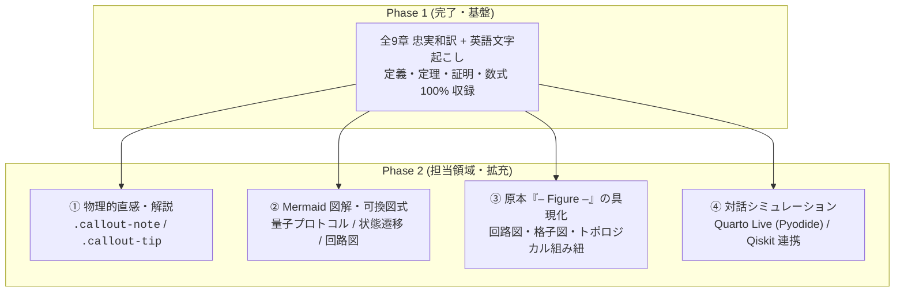

# Quantum Information 教科書制作 引き継ぎ書 (Phase 2: 解説・視覚化・シミュレーション拡充)

> **量子アルゴリズムの個別授業・ゼミ教材を引き継ぐ場合**：先に [授業と教材の詳細引き継ぎ](QUANTUM_ALGORITHMS_TEACHING_HANDOFF.md)（2026年10月24日）を読んでください。ユーザーの学習目的・説明への要望・現在の教材・未完了事項・公開環境をまとめています。

> [!IMPORTANT]
> **後続エージェントへの指示**: 本ドキュメントは、**Phase 1（全章完全忠実翻訳・英語文字起こし）の完了を受けて、Phase 2（解説・視覚化・シミュレーションの拡充）を担当するエージェント向け**の引き継ぎ書です。このドキュメントを読むだけで、プロジェクトの現状、規約、Phase 2 の目標および作業手順を即座に把握し、作業を開始できるように設計されています。

---

## 1. プロジェクトの現状と実績 (Phase 1 完了)

John Preskill 教授の講義ノート全 9 章（Chapter 1〜10、※Chapter 9 欠番）について、**省略ゼロの忠実翻訳および完全英語文字起こし（Phase 1）が 100% 完了**し、本番環境に公開されています。

- **公開 URL**: [https://yama662607.github.io/Quantum-information/](https://yama662607.github.io/Quantum-information/)
- **教科書本体**: [https://yama662607.github.io/Quantum-information/textbook-preskill/textbook.html](https://yama662607.github.io/Quantum-information/textbook-preskill/textbook.html)
- **マージ済み PR**: [#3 (feat(preskill): complete Phase 1 for all chapters (Ch 1-10))](https://github.com/yama662607/Quantum-information/pull/3)
- **現在のベースラインブランチ**: `master` (最新コミットで同期済み、`just check` 全件 PASS)

### 全 9 章の収録実績

| 章 | タイトル | ページ数 | 収録数式・演習 | 親ファイル | 断片ディレクトリ |
| :--- | :--- | :---: | :---: | :--- | :--- |
| **Chapter 1** | Introduction and Overview | 30p | 式 1.1〜1.37 | `chapter1.qmd` | `chapter1/_*.qmd` |
| **Chapter 2** | Foundations I: States and Ensembles | 53p | 式 2.1〜2.187, 演習 2.1〜2.9 | `chapter2.qmd` | `chapter2/_*.qmd` |
| **Chapter 3** | Foundations II: Measurement and Evolution | 65p | 式 3.1〜3.257, 演習 3.1〜3.13 | `chapter3.qmd` | `chapter3/_*.qmd` |
| **Chapter 4** | Quantum Entanglement | 70p | 式 4.1〜4.192, 演習 4.1〜4.10 | `chapter4.qmd` | `chapter4/_*.qmd` |
| **Chapter 5** | Classical Circuits & Quantum Circuits | 54p | 式 5.1〜5.142, 演習 5.1〜5.6 | `chapter5.qmd` | `chapter5/_*.qmd` |
| **Chapter 6** | Quantum Algorithms | 64p | 式 6.1〜6.290, §6.1〜§6.10 | `chapter6.qmd` | `chapter6/_*.qmd` |
| **Chapter 7** | Quantum Error Correction | 92p | 式 7.1〜7.240, §7.1〜§7.24, 演習全問 | `chapter7.qmd` | `chapter7/_*.qmd` |
| **Chapter 8** | Topological Quantum Computation | 68p | 式 8.1〜8.118, §8.1〜§8.6, 演習全問 | `chapter8.qmd` | `chapter8/_*.qmd` |
| **Chapter 10** | Quantum Shannon Theory | 103p | 式 10.1〜10.373, §10.1〜§10.12, 演習全問 | `chapter10.qmd` | `chapter10/_*.qmd` |

---

## 2. Phase 2 の目的と 4 つのミッション

Phase 2 の目的は、忠実な翻訳テキストという盤石の土台の上に、**読者の直感的理解を飛躍的に高める「解説・視覚化・対話シミュレーション」を組み込み、世界最高の量子情報 Web 教科書を創り上げること**です。



### ミッション詳細

1. 💡 **物理的直感と解説 (`callout-note` / `callout-tip`)**:
   - 抽象的・技巧的な数式展開に対して、「物理的に何を意味しているのか」「実験系ではどう測るのか」「なぜこの定義が自然なのか」を直感的な言葉で補足します。
   - 歴史的経緯や関連するノーベル賞級の発見（Einstein-Podolsky-Rosen、Bell、Aspect、Shor、Kitaev 等）の文脈を挿入します。

2. 🧜 **Mermaid 可換図式 & プロトコルフロー**:
   - 量子テレポーテーション、超高密度符号化、量子暗号（BB84 / E91）の通信・測定シーケンス図。
   - 量子演算（Kraus表現、Stinespring拡張）の可換図式。
   - アルゴリズム（Deutsch-Jozsa、Grover、Shor）の計算フロー。

3. 📐 **原本の「– Figure –」箇所の完全具現化**:
   - Preskill の原本講義ノートでは、多数の箇所で `– Figure –` とだけ書かれ、手書き図や量子回路図が本文中に直接埋め込まれていない場所があります（例: Chapter 7 のシンドローム測定回路、Chapter 8 の組み紐、Chapter 10 のチャネル容量図など）。
   - これらを Mermaid、ASCII アート、SVG、または Matplotlib/Qiskit 回路図として具現化します。

4. 🐍 **対話シミュレーション & Qiskit 連携**:
   - **Quarto Live (Pyodide)**: ブラウザ上で動く Python コードスニペット（Bloch球回転、CHSH 不等式の相関値プロット、イオントラップのモード解析など）。
   - **Qiskit ノートブック連携**: `quarto/qiskit/` 配下の既存実装と本文の対応リンクを強化。

---

## 3. 鉄則ルール・執筆規約（Guideline）

> [!CAUTION]
> **Phase 2 における絶対ルール**:
> 1. **Phase 1 テキストの保護**: 原文の記述、定義、定理、補題、証明、式番号、脚注を**削除・要約・改変してはならない**。Phase 2 の解説や図は、該当する段落の直後または節の末尾に**追記（Enrichment）**の形で挿入する。
> 2. **Fenced Div の空行**: `::: {.callout-...}` などの囲みを使用する場合、**閉じ括弧 `:::` の直前には必ず空行を挿入**する（Quarto/Pandoc のパースエラー防止）。
> 3. **数式ラベル構文**: 数式番号・クロスリファレンスは必ず `$$ {#eq-X.Y}` の形式を厳守する（数式内に `\tag{...}{#eq-...}` と書かない）。
> 4. **小さく刻む**: 1セクションずつ編集し、都度 `just check` で検証する。

### Quarto Live (Pyodide) の利用ルール
- 追加パッケージは親ファイル（`textbook.qmd`）の YAML `pyodide.packages` で宣言する（セル内 `micropip.install` は race するため禁止）。
- 日本語フォントは `assets/fonts/NotoSansJP-Regular.ttf` を `pyfetch` で読み込み、描画セル内に inline で設定する（詳細は `docs/quarto-live.md` 参照）。
- `{ojs}` が 1 つも無いファイルに `{pyodide}` を置く場合は、ダミー `{ojs}` セル（`_quarto_live_loader = 1`）を配置する。

---

## 4. 章別 Phase 2 推奨処方箋（ロードマップ）

| 章 | 推奨追加要素 | 優先度 |
| :--- | :--- | :---: |
| **Chapter 4<br/>(Entanglement)** | - Bell/CHSH不等式の古典限界 vs 量子限界の可視化プロット<br/>- 量子テレポーテーション & 超高密度符号化の Mermaid シーケンス図<br/>- BB84 / Ekert91 量子鍵配送プロトコルのフロー図 | ⭐️⭐️⭐️ (高) |
| **Chapter 6<br/>(Algorithms)** | - 量子位相推定（QPE）の回路図とステップ解説<br/>- Shor 因数分解アルゴリズムの古典-量子ハイブリッドフロー図<br/>- Grover 検索の幾何学的回転（状態ベクトルの反転）の図解 | ⭐️⭐️⭐️ (高) |
| **Chapter 7<br/>(Error Correction)** | - 原本で `– Figure –` となっている**シンドローム測定回路**の具現化<br/>- Shor 9量子ビット符号、Steane 7量子ビット符号のスタビライザー表と回路図<br/>- Toric Code（トーリック符号）の星型演算子・プラケット演算子の格子図 | ⭐️⭐️⭐️ (高) |
| **Chapter 8<br/>(Topological QC)** | - エニオンの組み紐（Braid群 $B_n$）の交差図<br/>- Pentagon / Hexagon 関係式の可換図式（Mermaid）<br/>- Fibonacci エニオンの融合則と量子ゲート構成図 | ⭐️⭐️ (中) |
| **Chapter 2<br/>(States & Ensembles)** | - Bloch球上のユニタリ回転と密度行列の可視化（既存 OJS/Plotly の磨き込み）<br/>- Schmidt分解とエンタングルメントの特異値分解対応の解説図<br/>- 状態間距離（Trace distance vs Fidelity）の幾何学的意味 | ⭐️⭐️ (中) |
| **Chapter 3<br/>(Measurement)** | - POVM 測定の Neumark 拡張定理（補助系結合）の可換図式<br/>- 3 つの量子チャネル（ビット反転、位相反転、振幅減衰）の Bloch 球収縮図<br/>- Kraus表現とStinespring表現の対応図 | ⭐️⭐️ (中) |
| **Chapter 10<br/>(Shannon Theory)** | - 古典 Shannon 情報理論（AEP、典型集合）の直感図<br/>- von Neumann エントロピーの強劣加法性（SSA）の幾何学的ベン図<br/>- 母プロトコル・父プロトコル・量子逆シャノン定理の階層図 | ⭐️ (低〜中) |

---

## 5. 作業環境と必須コマンド集

### 作業環境
- **作業ディレクトリ**: `/Users/daisukeyamashiki/Code/Learning/Quantum-information`
- **ランタイム**: `uv` (Python 3.12), `bun` (Node/JS)
- **ブランチ運用**: `master` から章ごとにトピックブランチを作成（例: `feature/phase2-ch4-entanglement`）

### 必須コマンド (`just`)

```bash
# 1. プレビューの起動 (ブラウザでリアルタイム確認)
just docs

# 2. 全体品質検証 (コード・LaTeX・Mermaid・Quarto構文チェック)
# ※ 編集後は必ず実行し、エラーがないことを確認する
just check

# 3. 書式・構造エラーの自動修正
just fix

# 4. Quarto 単体整合性チェック
just validate-docs
```

---

## 6. 次のエージェントへの最初のアクション推奨

1. `git checkout -b feature/phase2-ch4-entanglement` でトピックブランチを作成する。
2. `just docs` でプレビューサーバーを起動し、ブラウザで Chapter 4 を開く。
3. `quarto/textbook-preskill/chapter4/_4.4-using-entanglement.qmd` に、**量子テレポーテーションの Mermaid シーケンス図** と直感的解説の `callout-note` を追加してみる。
4. `just check` を実行して合格することを確認する。
