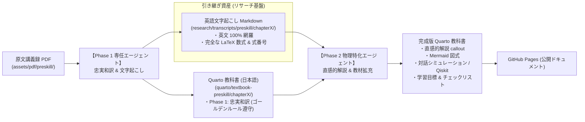

# エージェント協調・引き継ぎプロトコル (Agent Handoff Protocol)

本ドキュメントは、**Phase 1（忠実和訳 & 英語文字起こし専任エージェント）** と **Phase 2（物理・教材拡充特化エージェント）** の役割分担、成果物配置、および引き継ぎインターフェースを定めます。

---

## 1. 役割分担 (Role Separation)



### ① Phase 1 専任エージェント（現在のエージェント）の責務
1. **英語完全文字起こし (Transcripts) の作成・管理**:
   - 原文 PDF から、数式・式番号・注釈を含めた 100% 欠落のない英語 Markdown（`research/transcripts/preskill/chapterX/`）を作成する。
   - 物理担当エージェントが**「PDF を画像化して再読する手間」をゼロ**にする。
2. **Quarto 側での Phase 1 忠実和訳**:
   - `research/guidelines/writing_policy.md` のゴールデンルールに従い、定義・定理・補題・系・証明・Remark・Footnote・式番号を一切省かない日本語訳を `quarto/textbook-preskill/` 配下の断片ファイルに作成する。
   - 見出しレベルはすべて `##`（h2）で統一する。

### ② Phase 2 物理特化エージェントの責務
1. **文字起こしドキュメントの参照**:
   - `research/transcripts/` を直接読み込み、正確な英語の文脈・数式を把握する。
2. **Quarto 教科書の解説拡充**:
   - 既存の Phase 1 本文を壊さず、その直後または適切な位置に以下の要素を追記する：
     - `::: {.callout-note appearance="simple"}`: 物理的直感・意味論の解説
     - `::: {.callout-tip}`: 計算の要点や Qiskit 実装例
     - `::: {.callout-warning collapse="true"}`: ゼミ発表チェックリスト
     - Mermaid による概念関係図・フローチャート・可換図式
     - 冒頭の「この節の学習目標」

---

## 2. 成果物のディレクトリ構造規約

```plaintext
Quantum-information/
├── research/
│   ├── transcripts/                     # 英語の完全文字起こし（Phase 2 エージェントへの提供用）
│   │   └── preskill/
│   │       ├── chapter1/
│   │       ├── chapter2/
│   │       │   ├── _sec2.1_axioms.md
│   │       │   ├── _sec2.2_qubit.md
│   │       │   ├── _sec2.3_density_operator.md
│   │       │   ├── _sec2.4_schmidt.md
│   │       │   ├── _sec2.5_ambiguity.md
│   │       │   ├── _sec2.6_distance.md
│   │       │   ├── _sec2.7_summary.md
│   │       │   └── _sec2.8_exercises.md
│   │       └── chapter3/
│   └── guidelines/                      # ガイドライン・方針書
│       ├── writing_policy.md
│       └── agent_handoff_protocol.md    # 本書
└── quarto/
    └── textbook-preskill/               # GitHub Pages に公開される日本語教科書本体
        └── chapter2/
            ├── _2.1-axioms.qmd
            ├── _2.2-qubit.qmd
            └── ...
```

---

## 3. 文字起こし (Transcripts) のフォーマット規約

各文字起こしファイルは、以下の構成を厳守してください：

```markdown
# Section X.Y: Title [PDF Page NN]

<!-- ============================================================ -->
<!-- Source: chapX.pdf, Physical Pages: Start-End                 -->
<!-- Transcribed: YYYY-MM-DD                                      -->
<!-- ============================================================ -->

<!-- Page NN -->
Raw English paragraphs...

$$
\text{Exact LaTeX Equation}
$$ {#eq-X.YY}

::: {#def-X.YY name="Definition Name"}
Exact Definition in English
:::

::: {#thm-X.YY name="Theorem Name"}
Exact Theorem in English
:::

::: {.proof}
Exact Proof in English
:::
```

これにより、後続の物理特化エージェントは文字起こしファイルをそのまま読むだけで、完全に原文の文脈を再現できます。
